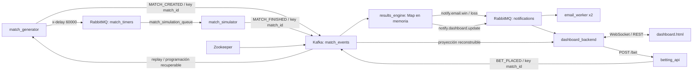

# LIVE BET ARENA · Node.js

Simulador académico de apuestas con puntos virtuales. No utiliza dinero real, pagos, depósitos ni premios de valor real.

La implementación activa sigue el nuevo enunciado: **Node.js + Kafka como fuente única de verdad + RabbitMQ como temporizador y enrutador de notificaciones**. No requiere Java, Maven ni PostgreSQL. La implementación anterior se conserva en `legacy/java/` y no se incluye en las imágenes actuales.

## Arquitectura



Hay **seis servicios Node.js y un cliente HTML**: los siete componentes enumerados en el enunciado. Con Kafka, Zookeeper y RabbitMQ son nueve servicios de Compose; las dos réplicas de email_worker producen diez contenedores.

El motor mantiene agregados `Match` en un `Map`, apuestas, saldos y movimientos en memoria. Al arrancar crea un consumidor nuevo con `fromBeginning: true`, lee todo Kafka y reconstruye el estado. No carga un journal SQL ni snapshots en disco. Kafka guarda los tres tipos de evento de forma append-only, sin compactación y con retención ilimitada. El único estado inicial adicional son tres identidades de demostración fijas, cada una con 10.000 puntos.

**Una partición, con match_id como clave:** mantiene el orden por partido y, además, un orden global para las apuestas de una misma cuenta en partidos diferentes. Es una decisión del laboratorio para reconstruir los saldos de manera determinista. No cambiar el número de particiones del topic existente. La arquitectura y sus límites están en [docs/architecture.md](docs/architecture.md).

## Inicio

Requisitos: Docker con Compose v2 y contenedores Linux. Node.js 22+ y npm sólo son necesarios para pruebas fuera de Docker. Recomendación para esta topología: 4 vCPU, 6–8 GB RAM y 30 GB de disco libre, incluida la caché de imágenes.

```bash
cp .env.example .env
                              
docker compose up -d --build --wait --wait-timeout 240
```

PowerShell con Docker en Ubuntu WSL:

```powershell
Copy-Item .env.example .env                          
./scripts/compose-wsl.ps1 up -d --build --wait --wait-timeout 240
```

El wrapper mantiene un proceso WSL oculto para que la distribución siga activa. Para detener el laboratorio:

```powershell
./scripts/compose-wsl.ps1 stop
./scripts/wsl-keepalive.ps1 -Stop
```

Abrir **http://localhost:8080** o **http://localhost:8080/dashboard.html**.

| Cuenta | user_id | Contraseña | Rol |
| --- | --- | --- | --- |
| alex@arena.test | u555 | DEMO_PASSWORD de .env | USER |
| sam@arena.test | u556 | DEMO_PASSWORD de .env | USER |
| admin@arena.test | admin | ADMIN_PASSWORD de .env | ADMIN |

El proyecto Compose se llama `live-bet-arena-node`, con volúmenes distintos de la versión Java. No mezcla el topic anterior de tres particiones con el log Node de una partición. Si la versión Java sigue activa, detenerla antes porque ambas usan el puerto 8080. Sus volúmenes se conservaron.

## Configuración

| Variable | Uso |
| --- | --- |
| RABBIT_PASSWORD | Obligatoria; contraseña de arena en RabbitMQ |
| DEMO_PASSWORD | Obligatoria; contraseña Basic de Alex y Sam |
| ADMIN_PASSWORD | Obligatoria; contraseña Basic de administrador |
| HTTP_PORT | Puerto del host, 8080 por defecto |
| KAFKA_SERVERS | Broker interno, kafka:9092 |
| RABBIT_HOST / RABBIT_USER | rabbitmq / arena |
| BETTING_URL / ENGINE_URL | URLs internas de betting-api y results-engine |

Las variables opcionales se pueden inyectar con overrides Compose o al ejecutar Node directamente. No guardar `.env` en Git. El archivo anterior puede contener DB_PASSWORD: Node no lo utiliza. El dashboard es el único puerto publicado y está ligado a 127.0.0.1. Cada servicio usa usuario `node`, límites de CPU/memoria, un Dockerfile multietapa y healthcheck de disponibilidad después de reconstruir Kafka.

## Eventos

Topic: **match_events**, clave de cada mensaje: **match_id**.

```json
{"event_id":"uuid","event_type":"MATCH_CREATED","match_id":"m123","teams":["A","B"],"occurred_at":"2026-11-18T19:00:00.000Z","closes_at":"2026-11-18T19:01:00.000Z"}
{"event_id":"bet:r1","event_type":"BET_PLACED","match_id":"m123","user_id":"u555","bet_id":"r1","request_id":"r1","bet_on":"HOME","amount":100,"occurred_at":"2026-11-18T19:00:10.000Z"}
{"event_id":"finish:m123","event_type":"MATCH_FINISHED","match_id":"m123","winner":"HOME","occurred_at":"2026-11-18T19:01:00.000Z"}
```

Los timestamps son instantes UTC; `closes_at` queda exactamente 60 segundos después de la creación. El generador publica aproximadamente cada diez segundos. El simulador publica un resultado cuando RabbitMQ entrega el comando diferido; el timestamp lógico del resultado es la hora de cierre. La demora real de procesamiento puede ser mayor si los brokers están detenidos.

## Temporizador y notificaciones

| Exchange | Tipo | Routing key | Cola |
| --- | --- | --- | --- |
| match_timers | x-delayed-message, x-delayed-type=direct | match.finish | match_simulation_queue |
| notifications | topic | notify.email.win | email_notifications |
| notifications | topic | notify.email.loss | email_notifications |
| notifications | topic | notify.dashboard.* | dashboard_updates |

El generador registra primero MATCH_CREATED en Kafka. Su consumidor del log programa un mensaje RabbitMQ `{ "match_id": "..." }` con `x-delay` igual al tiempo restante hasta el cierre. Al reiniciar vuelve a leer los eventos y recupera los temporizadores; puede producir comandos duplicados, que son seguros.

El simulador no usa setTimeout para cerrar partidos: consume **match_simulation_queue**, comprueba la hora y publica MATCH_FINISHED. El resultado usa el hash de un identificador aleatorio del partido, de modo que es aleatorio al crear el identificador y reproducible ante reintentos. Las pruebas pueden verificarlo sin depender del reloj o de un broker.

Las publicaciones AMQP esperan publisher confirms. El plugin diferido no soporta `mandatory`; las colas y bindings se declaran durables antes de consumir/publicar. El plugin está fijado a RabbitMQ 4.1.0 con plugin 4.1.0, según el requisito académico. Su repositorio está archivado; no es una plataforma propuesta para producción.

Los workers imprimen correo **simulado**, sin contactar servicios externos. RabbitMQ entrega cada tarea a uno de los dos consumidores. Al reconstruir el motor se vuelven a emitir notificaciones históricas: la entrega es al menos una vez y pueden repetirse logs de correo. Las liquidaciones y saldos no se repiten, porque se reconstruyen de forma pura con deduplicación de event_id.

## API y dashboard

Las rutas privadas requieren HTTP Basic. El correo autenticado define la identidad; user_id, si se envía, debe coincidir.

| Ruta | Función |
| --- | --- |
| GET /api/snapshot | Usuario, saldo, partidos, apuestas y movimientos propios |
| GET /api/admin | Participantes y actividad; sólo ADMIN |
| GET /api/admin/engine | Estado y digest financiero del motor; sólo ADMIN |
| POST /bet | Publicar apuesta en Kafka y esperar su validación en la proyección |
| WS /ws | Señales de actualización; el cliente obtiene su snapshot privado |
| GET /health | Disponible en cada servicio |
| GET /actuator/health | Alias conservado para las herramientas de verificación |

Contrato del enunciado:

```bash
curl -u alex@arena.test -H 'Content-Type: application/json' \
  -d '{"user_id":"u555","match_id":"UUID_DE_PARTIDO","bet_on":"A","amount":100,"request_id":"uuid-nuevo"}' \
  http://localhost:8080/bet
```

También se acepta el contrato del frontend: `matchId`, `selection: HOME/AWAY`, `stake`, `requestId`. La selección A equivale a HOME; B equivale a AWAY. `request_id` es opcional para clientes simples, pero debe enviarse y conservarse al reintentar para evitar repetir una intención de apuesta.

La API valida el plazo y saldo de su proyección; el motor vuelve a validarlos al consumir el evento. Un BET_PLACED que llegue después de MATCH_FINISHED queda REJECTED, sin débito. Los cálculos usan centésimas enteras, sin aritmética decimal de coma flotante sobre saldos. Ganar retorna el doble de lo apostado: incluye el principal. No hay empates.

Respuestas: 202 apuesta registrada/aceptada, 400 datos o saldo, 401 autenticación, 403 permisos, 409 cierre/rechazo/conflicto de idempotencia, 503 reconstrucción o confirmación pendiente. Ante confirmación pendiente, reintentar con la misma request_id.

## Pruebas

```bash
npm ci
npm run verify
node scripts/e2e.mjs
node scripts/recovery-check.mjs
bash scripts/check-duplicate.sh
```

Desde PowerShell, el último comando puede ejecutarse como `./scripts/compose-wsl.ps1 exec -T results-engine node scripts/duplicate-check.mjs`.

- Las pruebas unitarias usan `node:test` y `assert`, sin brokers ni bases de datos.
- La E2E realiza una apuesta de 100 puntos, espera los 60 segundos reales y comprueba ganador, saldo, ledger, autenticación, roles, rechazo tardío y WebSocket.
- La prueba de recuperación reemplaza el contenedor results-engine, destruyendo su memoria, y compara el digest de apuestas, saldos y ledger reconstruido sólo desde Kafka. Ejecutar sin otras apuestas simultáneas y después de liquidar las existentes.
- La prueba de duplicado vuelve a publicar MATCH_FINISHED y comprueba tanto que el motor consumió el nuevo offset como que su digest financiero permaneció igual.

`./scripts/verify.ps1` o `bash scripts/verify.sh` instalan dependencias, ejecutan pruebas, construyen la topología y corren la E2E. Los informes se guardan en `artifacts/`, ignorado por Git. Consultar [docs/validation.md](docs/validation.md) para distinguir los resultados de la versión Node de los antiguos resultados Java.

## Operación

```bash
docker compose ps
docker compose logs -f results-engine match-simulator email-worker
bash scripts/inspect.sh
docker compose exec kafka kafka-console-consumer --bootstrap-server kafka:9092 --topic match_events --from-beginning --property print.key=true
docker compose stop
docker compose start
```

`stop`, `start` y `down` conservan los volúmenes. `down -v` elimina el log y todo el historial: los scripts no lo ejecutan. No borrar Kafka para reiniciar únicamente el motor.

| Problema | Acción |
| --- | --- |
| Topic con tres particiones | Estás usando el log anterior; arrancar el proyecto live-bet-arena-node con sus propios volúmenes |
| STARTING después de reiniciar | El servicio está leyendo el log; esperar y consultar logs |
| Puerto 8080 ocupado | Detener el despliegue Java u otro proceso; o cambiar HTTP_PORT |
| No se cierran partidos | Comprobar plugin, cola match_simulation_queue, consumidores y Kafka |
| Un evento inválido bloquea reconstrucción | Revisar el evento y su productor; el sistema falla cerrado para no saltar movimientos |
| Dashboard muestra reconexión | Revisar /ws, estado de dashboard-backend y cabeceras Upgrade si hay proxy |
| Ubuntu WSL se apaga | Arrancar mediante compose-wsl.ps1, que activa el proceso de continuidad |
| El broker se cae durante una solicitud | Recuperar infraestructura y reintentar con la misma request_id |

Guía de Ubuntu 26.04/VirtualBox: [docs/ubuntu-virtualbox.md](docs/ubuntu-virtualbox.md). Referencias primarias: [KafkaJS consumers](https://kafka.js.org/docs/consuming), [amqplib confirm channels](https://amqp-node.github.io/amqplib/channel_api.html), [RabbitMQ delayed plugin](https://github.com/rabbitmq/rabbitmq-delayed-message-exchange).