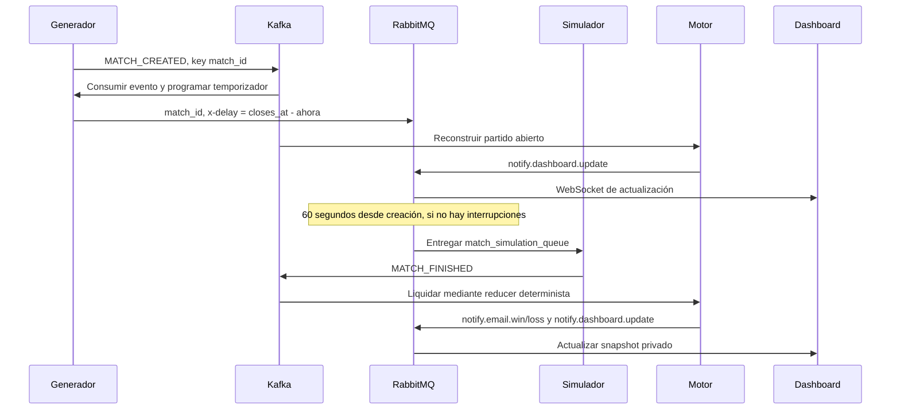

# Arquitectura Node.js y fuente de verdad

## Event Sourcing

Kafka es la única fuente persistente del dominio. Los servicios activos no tienen tablas SQL, journals externos ni volúmenes de aplicación. `shared/domain.mjs` es un reducer determinista: una secuencia de eventos produce los mismos partidos, apuestas, saldos y movimientos. `results_engine` mantiene el Map solicitado y vuelve a construirlo desde el offset cero al arrancar.

`fromBeginning: true` no fuerza un replay si un grupo ya tiene offsets confirmados. Por eso cada arranque usa un grupo nuevo y `autoCommit: false`. El servicio obtiene primero el high watermark, consume desde el principio y sólo declara readiness al alcanzar ese límite. Continúa consumiendo eventos nuevos después. No se reutiliza una caché de otro proceso.

Las identidades demo y los 10.000 puntos iniciales son condiciones de génesis fijas en código. Todas las modificaciones posteriores del saldo proceden exclusivamente de BET_PLACED y MATCH_FINISHED del log. No se admiten depósitos ni ajustes administrativos de saldo.

## Orden y validación

Todos los eventos usan match_id como key. El topic tiene una sola partición: además del orden por partido, preserva un orden entre apuestas de la misma cuenta en diferentes partidos. Con varias particiones haría falta un agregado de cuenta o un protocolo adicional para ordenar débitos; este laboratorio elige explícitamente una partición y limita su escalabilidad.

La API y el dashboard mantienen proyecciones independientes leyendo Kafka. La API hace una validación temprana y publica el comando de apuesta como BET_PLACED. El reducer realiza la validación definitiva: el partido debe existir y estar abierto en ese punto del stream, el timestamp debe estar antes del cierre y el usuario debe conservar saldo. Una apuesta rechazada por el motor queda en el log pero no descuenta puntos. Esto evita compensaciones dependientes de otra base de datos.

Los tres eventos de negocio son MATCH_CREATED, BET_PLACED y MATCH_FINISHED. El cierre definitivo es inmutable. El agregado canónico usa CLOSED con ganador, como en el enunciado. El DTO de la interfaz conserva FINISHED para compatibilidad visual; al agotarse el tiempo se deshabilitan las nuevas apuestas incluso antes de procesar el resultado.

## Temporizadores recuperables

No existe una transacción distribuida entre Kafka y RabbitMQ. La brecha se resuelve releyendo Kafka: si el generador cae antes de publicar un temporizador o antes de confirmar su publicación, al reiniciar vuelve a programar los MATCH_CREATED. Un mensaje ya vencido se envía con un retraso mínimo de 1 ms. Los duplicados son esperados y seguros. El simulador reconstruye primero el log y descarta comandos de partidos ya finalizados.

El ganador se deriva de SHA-256 del UUID aleatorio del partido. Cada UUID aporta aleatoriedad al encuentro y hace reproducible el ganador en reintentos, evitando dos resultados distintos para el mismo evento. El event_id de finalización y su timestamp también son deterministas.

## Efectos e idempotencia

El reducer recuerda event_id y no vuelve a descontar, liquidar ni modificar el ledger ante un duplicado. Un partido ya finalizado con el mismo ganador tampoco liquida de nuevo si recibe otro ID de evento. Un resultado diferente se rechaza como corrupción del contrato.

La intención de apuesta se identifica con request_id. Reintentar conserva el evento; cambiar sus datos con la misma clave produce 409. La API comprueba el contenido de solicitudes ya conocidas antes de devolver su resultado. Si el cliente omite request_id, el servidor genera una y los reintentos del cliente se consideran intenciones nuevas.

El motor publica en RabbitMQ los efectos derivados del replay y espera publisher confirms. Caer entre aplicar un evento y publicar una notificación no pierde la notificación: al reiniciar se reconstruye todo y se vuelve a emitir. A cambio, pueden repetirse notificaciones históricas. Los workers deduplican por ID dentro de su proceso; no se promete correo exactamente una vez entre réplicas o reinicios. Como sólo son logs simulados, este comportamiento está documentado y no modifica los puntos.

El dashboard espera a que su proyección haya consumido el ID notificado antes de transmitir la señal WebSocket. Las señales públicas no contienen datos privados; cada cliente solicita su propio snapshot autenticado. Mantiene reconciliación periódica para recuperar señales perdidas.

## Límites

Una réplica de generador, API, simulador, motor y dashboard. Dos workers compiten en la cola email_notifications. Escalar el dashboard requeriría una cola por instancia para fanout. Kafka, RabbitMQ y Zookeeper tienen una sola instancia: no es una topología de alta disponibilidad.

Los Maps y el log crecen sin límite deliberadamente para la demostración de replay. No hay snapshots ni archivado, por lo que el tiempo de arranque aumenta con la historia. Los grupos de lectura se crean por arranque y no guardan offsets de recuperación. Un evento inválido bloquea el replay y causa reinicio; no se omiten movimientos silenciosamente.

El plugin diferido usa almacenamiento del broker con una sola réplica y no soporta mandatory. Las colas y bindings son durables, y las publicaciones esperan confirmaciones. Deshabilitar el plugin o perder su volumen puede perder temporizadores pendientes; la relectura de MATCH_CREATED desde el generador permite volver a programarlos si Kafka se conserva. La combinación RabbitMQ/plugin 4.1.0 está fijada para cumplir el enunciado académico; el proyecto del plugin está archivado.

HTTP Basic se limita al entorno local y los secretos van en .env. Una publicación remota requiere TLS. El proyecto sólo usa puntos virtuales y cuentas ficticias.