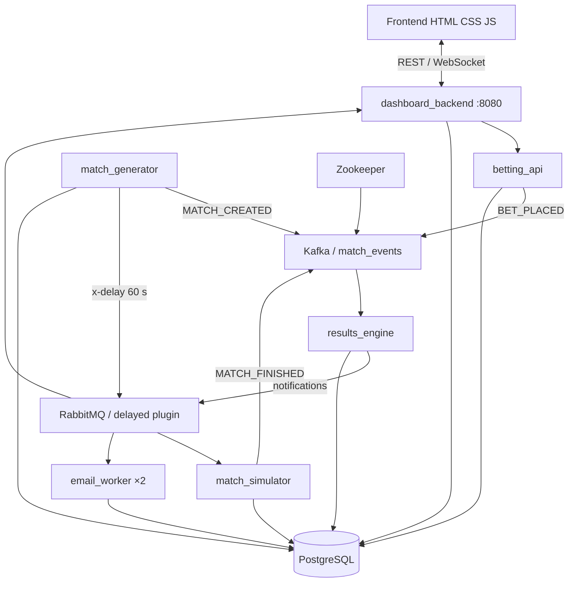

# LIVE BET ARENA

Simulador académico distribuido de apuestas deportivas con **puntos virtuales**. Cada participante empieza con **10.000 puntos**. No hay dinero real, depósitos, retiros ni integración con pagos.

Se crean encuentros ficticios aproximadamente cada 10 segundos, con una ventana de apuestas de 60 segundos. RabbitMQ programa el cierre real; Kafka transporta los eventos por partido; el motor valida, liquida y notifica. El dashboard recibe señales WebSocket sin recargas manuales.

## Arquitectura



La base PostgreSQL es compartida para conservar transacciones de reservas y saldos. Los seis servicios son procesos independientes con eventos reales. Este compromiso de aislamiento de datos, la consistencia, la reconstrucción del agregado y los límites operativos están documentados en [architecture.md](docs/architecture.md).

## Tecnologías y estructura

Java 17, Spring Boot 3.5.7, Spring Security, Spring Data JPA/Hibernate, Maven, Kafka con Zookeeper, RabbitMQ 4.1.0 con Delayed Message Exchange 4.1.0, PostgreSQL 16, Docker Compose, HTML5/CSS3/JavaScript, WebSocket nativo, JUnit 5 y Mockito.

```text
app/
├── pom.xml                         # Reactor Maven
├── arena-common/                   # Contratos, dominio, outbox y adaptadores
├── match-generator/                # Generación de encuentros y temporizadores
├── betting-api/                    # REST, reservas y cuentas demo
├── match-simulator/                # Consumidor de temporizadores y ganador
├── results-engine/                 # Agregados, journal y liquidaciones
├── dashboard-backend/              # REST privado, proxy /bet y WebSocket
├── email-worker/                   # Notificaciones simuladas; dos réplicas
├── frontend/                       # index.html, dashboard.html, css/ y js/
├── infrastructure/                 # SQL, plugin RabbitMQ y notas Kafka
├── scripts/                        # Verificación y prueba E2E
├── docs/                           # Arquitectura, despliegue y validación
├── docker-compose.yml
└── .env.example
```

## Requisitos

- Docker Engine/Desktop con Compose v2 y contenedores Linux.
- Para compilar fuera de Docker: JDK 17+ y Maven 3.9+.
- Node.js 22+ para el script E2E (la aplicación no requiere Node).
- Para esta topología completa: asignar aproximadamente 8 GB RAM a Docker/VM, 4 vCPU y 30 GB de espacio libre. Son recursos recomendados para el proyecto, no requisitos oficiales de Ubuntu.
- Internet durante la primera compilación para descargar dependencias, imágenes y plugin.

## Inicio rápido

Ejecutar desde este directorio.

Linux:

```bash
cp .env.example .env
                                                  
docker compose up -d --build
docker compose ps
```

PowerShell:

```powershell
Copy-Item .env.example .env
                                                  
docker compose up -d --build
docker compose ps
```

Las contraseñas demo y admin deben tener al menos 10 caracteres. No confirmar `.env` en Git. La primera construcción puede tardar varios minutos. Esperar a que todos los servicios estén saludables y abrir **http://localhost:8080** o **http://localhost:8080/dashboard.html**.

Los Dockerfiles comparten una etapa de compilación del reactor y una caché Maven de BuildKit. Esa etapa ejecuta también las pruebas aisladas; después cada imagen copia sólo el JAR de su servicio a la etapa JRE.

Si Docker está instalado dentro de Ubuntu WSL, usar desde PowerShell `./scripts/compose-wsl.ps1 up -d --build` y `./scripts/compose-wsl.ps1 ps`. El wrapper ejecuta Compose en WSL dentro del mismo directorio del proyecto; no requiere Docker Desktop. `verify.ps1` detecta este caso automáticamente.

Al arrancar, el wrapper mantiene un proceso WSL oculto para que Ubuntu no se apague al cerrar la última sesión: [Microsoft documenta que systemd por sí solo no mantiene WSL activo](https://learn.microsoft.com/en-us/windows/wsl/systemd). Para terminar la sesión del laboratorio: `./scripts/compose-wsl.ps1 stop` y después `./scripts/wsl-keepalive.ps1 -Stop`. Esto no elimina datos ni termina otras sesiones WSL.

| Cuenta | Rol | Contraseña |
| --- | --- | --- |
| alex@arena.test | USER | DEMO_PASSWORD de `.env` |
| sam@arena.test | USER | DEMO_PASSWORD de `.env` |
| admin@arena.test | ADMIN | ADMIN_PASSWORD de `.env` |

Las cuentas se crean una sola vez, con hash BCrypt y saldo inicial de 10.000. Cambiar las variables después no cambia los hashes ya persistidos. PostgreSQL, Kafka, Zookeeper y RabbitMQ no publican puertos al host. Sólo el dashboard se publica, ligado a `127.0.0.1`; no se abre automáticamente a una red pública.

Para apostar: iniciar sesión, elegir local o visitante, indicar puntos y confirmar. El saldo refleja la reserva; `PENDING` pasa a `ACCEPTED` al validar el motor, luego a `WON` o `LOST`. Una carrera con el cierre puede producir `REJECTED` y reembolso. El retorno ganador es el doble de la apuesta, incluyendo los puntos reservados.

## Configuración

| Variable | Función / valor predeterminado |
| --- | --- |
| DB_PASSWORD | Contraseña obligatoria de PostgreSQL |
| RABBIT_PASSWORD | Contraseña obligatoria de RabbitMQ |
| DEMO_PASSWORD | Contraseña inicial de usuarios demo |
| ADMIN_PASSWORD | Contraseña inicial de admin |
| HTTP_PORT | Puerto local del dashboard; 8080 |
| DB_URL | JDBC; `jdbc:postgresql://postgres:5432/arena` |
| DB_USER | Usuario PostgreSQL; `arena` |
| KAFKA_SERVERS | Broker; `kafka:9092` |
| RABBIT_HOST / RABBIT_USER | `rabbitmq` / `arena` |
| BETTING_URL | Destino interno del proxy; `http://betting-api:8080` |

Las variables opcionales se pueden inyectar al ejecutar Java directamente o mediante un override de Compose. Cada imagen ajusta la JVM con `UseContainerSupport`, `MaxRAMPercentage=75.0` y `ExitOnOutOfMemoryError`, usa JRE 17 y usuario sin privilegios. CPU y memoria se limitan por servicio. Los datos de infraestructura viven en volúmenes persistentes.

## API REST

Todas las rutas de datos requieren HTTP Basic. El correo autenticado determina el usuario; no se acepta un `userId` elegido por el cliente.

| Método / ruta | Servicio | Respuesta |
| --- | --- | --- |
| GET / | dashboard_backend | Frontend |
| GET /api/snapshot | dashboard_backend | Usuario seguro, encuentros, contadores, apuestas y movimientos propios |
| GET /api/admin | dashboard_backend | Usuarios y auditoría; sólo ADMIN |
| POST /bet | dashboard_backend → betting_api | 202 con reserva PENDING o apuesta existente para la misma requestId |
| GET /actuator/health | Cada servicio | Salud de aplicación y dependencias |
| WS /ws | dashboard_backend | Señales `{"type":"UPDATE"}` sin datos personales |

Ejemplo desde Ubuntu (curl solicita la contraseña sin incluirla en el comando):

```bash
curl -u alex@arena.test http://localhost:8080/api/snapshot
curl -u alex@arena.test -H 'Content-Type: application/json' \
  -d '{"matchId":"UUID_DE_UN_PARTIDO_ABIERTO","selection":"HOME","stake":100,"requestId":"UUID_NUEVO"}' \
  http://localhost:8080/bet
```

`selection`: HOME/AWAY. `stake`: positivo, máximo dos decimales y hasta 1.000.000; se exige saldo suficiente. `requestId`: UUID de idempotencia, conservarlo al reintentar la misma solicitud. Cambiar los datos con la misma clave devuelve 409. Un usuario no puede recuperar apuestas de otro con esa clave. Errores: 400 datos/saldo, 401 autenticación, 403 autorización, 409 cierre/conflicto, 503 API interna no disponible.

## Kafka y RabbitMQ

Kafka: topic **match_events**, tres particiones, clave **match_id**, sin compactación y retención ilimitada. Eventos: MATCH_CREATED, BET_PLACED, MATCH_FINISHED. Consumidor `results-engine`, inicio earliest para un grupo nuevo. Los offsets sólo se confirman después de procesar la transacción. Los eventos se publican mediante outbox con confirmación de Kafka.

| Exchange | Tipo | Routing key | Cola |
| --- | --- | --- | --- |
| match_timers | x-delayed-message; x-delayed-type=direct | match.finish | match_simulation_queue |
| notifications | topic | notify.email.win | email_notifications |
| notifications | topic | notify.email.loss | email_notifications |
| notifications | topic | notify.dashboard.update | dashboard_updates |

El generador persiste la hora absoluta de cierre y su orden de temporizador en la misma transacción. El dispatcher manda `x-delay` con los milisegundos restantes (60.000 en el caso inmediato), espera publisher confirm y marca la orden enviada. RabbitMQ almacena y entrega el mensaje al simulador tras el retraso. El simulador verifica la hora, se protege contra duplicados y publica el resultado vía Kafka. Una entrega temprana se vuelve a programar en RabbitMQ. El reloj visual del navegador y `@Scheduled` del generador **no** ejecutan el cierre de los partidos.

## Pruebas y verificación

Unitarias aisladas, sin brokers ni base de datos:

```bash
mvn -B verify
```

Verificación completa con infraestructura levantada:

```bash
node scripts/e2e.mjs
```

O compilar, levantar y verificar en un paso:

```bash
bash scripts/verify.sh
```

```powershell
./scripts/verify.ps1
```

La E2E utiliza una cuenta demo y gasta 100 puntos virtuales. Verifica autenticación, roles, creación automática, reserva, reintento idempotente, validaciones, aceptación del motor, cierre real, resultado, liquidación, saldo, rechazo tardío y señal WebSocket. Tarda aproximadamente 60–100 segundos. Escribe `artifacts/e2e-report.json` y termina con código no cero ante un fallo. Ejecutar sin otras apuestas simultáneas de Alex para que la comprobación exacta de saldo sea válida.

El estado real de las verificaciones realizadas en este entorno se registra en [docs/validation.md](docs/validation.md). La prueba de señal WebSocket comprueba transporte; la interacción visual del navegador es una verificación adicional.

## Operación y diagnóstico

```bash
docker compose logs -f results-engine match-simulator email-worker
docker compose exec rabbitmq rabbitmq-plugins list -e
docker compose exec rabbitmq rabbitmqctl list_exchanges name type
docker compose exec rabbitmq rabbitmqctl list_queues name messages consumers
docker compose exec kafka kafka-topics --bootstrap-server kafka:9092 --describe --topic match_events
docker compose exec postgres psql -U arena -d arena -c 'select outcome,count(*) from settlements group by outcome;'
bash scripts/inspect.sh
bash scripts/check-duplicate.sh
docker compose stop
docker compose start
```

| Problema | Diagnóstico / solución |
| --- | --- |
| Compose exige variables | Crear `.env` junto a docker-compose.yml y completar contraseñas |
| Imágenes/dependencias no descargan | Revisar salida de red, DNS, proxy y límites del registry; volver a construir |
| Puerto 8080 ocupado | Definir HTTP_PORT distinto en `.env` |
| SQL/schema validation falla | Consultar logs. El SQL inicial sólo se aplica a volúmenes nuevos; migrar cambios de esquema explícitamente |
| Partidos abiertos no finalizan | Revisar plugin habilitado, match_simulation_queue, simulador y outbox; Kafka debe estar saludable |
| Apuestas PENDING | Revisar results-engine y consumo de match_events; un evento inválido bloquea su partición |
| No aparece correo | Esperar confirmación outbox y revisar email-worker; hay dos réplicas |
| Dashboard desconectado | Revisar /ws en el proxy y permitir Upgrade; el navegador reintenta cada 3 s |
| Login falla tras cambiar .env | Las contraseñas iniciales ya quedaron persistidas; un cambio de variable no rota las cuentas |
| Contenedor termina por memoria | Revisar `docker compose ps`/logs y aumentar memoria de Docker/VM o límites del proyecto |

`docker compose down` conserva los datos. La opción `-v` elimina todos los volúmenes: usarla sólo al querer reiniciar deliberadamente la simulación y perder su historial. No se ejecuta automáticamente en scripts.

## Despliegue Ubuntu 26.04 LTS en VirtualBox

Guía paso a paso: [docs/ubuntu-virtualbox.md](docs/ubuntu-virtualbox.md). Incluye instalación de Docker, recursos de la VM, acceso desde el anfitrión mediante SSH y validación del flujo.

Referencias técnicas primarias: [Spring Boot 3.5 / Java](https://docs.spring.io/spring-boot/3.5/system-requirements.html), [plugin RabbitMQ y compatibilidad 4.1](https://github.com/rabbitmq/rabbitmq-delayed-message-exchange/releases/tag/v4.1.0), [instalación oficial de Docker en Ubuntu](https://docs.docker.com/engine/install/ubuntu/).
