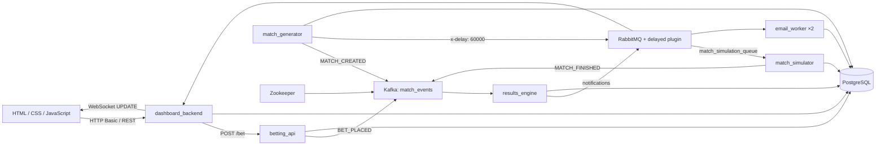
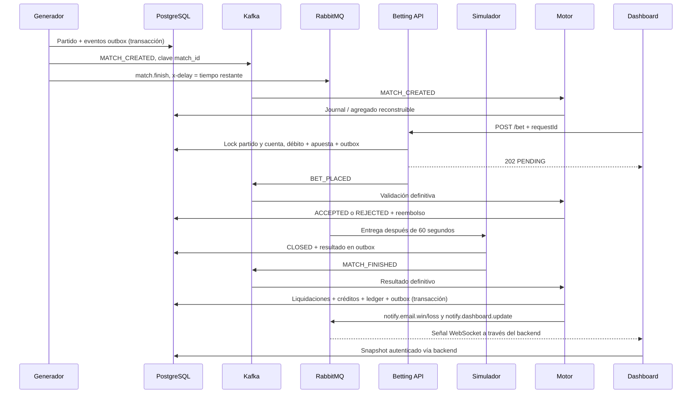

# Decisiones de arquitectura

## Responsabilidades y límites

Seis procesos Spring Boot desplegables de manera independiente. `arena-common` es una biblioteca de contratos, dominio, conectividad y persistencia; no es un séptimo servicio. Para permitir transacciones de saldo, reservas y liquidaciones sin introducir otro servicio fuera del alcance solicitado, los procesos comparten una base de datos PostgreSQL. Es un compromiso académico explícito: hay acoplamiento de esquema y no aislamiento de datos por servicio. Kafka y RabbitMQ son brokers reales y necesarios para finalizar el flujo.

| Proceso | Entrada | Escrituras | Salida |
| --- | --- | --- | --- |
| match-generator | cadencia de 10 s | matches, audit, outbox | MATCH_CREATED; temporizador AMQP |
| betting-api | POST /bet autenticado | reservas, bets, ledger, outbox | BET_PLACED |
| match-simulator | match_simulation_queue | estado CLOSED, outbox | MATCH_FINISHED |
| results-engine | match_events | journal, estados, settlements, ledger, saldos, audit | notificaciones AMQP |
| email-worker ×2 | email_notifications | delivered_notifications, audit | correo simulado en consola |
| dashboard-backend | REST, dashboard_updates | ninguna tabla | snapshots privados; señales WebSocket públicas |



## Secuencia, consistencia y reintentos



La API bloquea el partido antes de bloquear la cuenta y usa la hora del servidor tras adquirir los locks. Exactamente en `closes_at` ya no se permite reservar. La API exige que MATCH_CREATED ya haya llegado al motor antes de registrar una apuesta.

Las publicaciones salen de una outbox transaccional. Cada proceso despacha sus filas por ID y espera confirmación del broker. Caer después de publicar y antes del commit puede duplicar un mensaje. La garantía es **al menos una vez** con efectos de liquidación idempotentes; no existe una transacción distribuida entre PostgreSQL, Kafka y RabbitMQ.

El motor procesa por partición, bloquea el partido y deduplica por `eventId`. `settlements.bet_id` es clave primaria y el ledger tiene unicidad por apuesta y concepto. El consumidor registra journal, saldo, liquidación y nuevas notificaciones en la misma transacción. Un fallo revierte todo y Kafka vuelve a entregar. Los errores de Kafka reintentan indefinidamente para no saltarse eventos financieros del simulador; un mensaje malformado bloquea su partición y requiere diagnóstico manual.

Debido a productores independientes, un BET_PLACED pendiente puede llegar después de MATCH_FINISHED. En ese caso el motor lo rechaza y reintegra íntegramente su reserva, aunque el cliente haya recibido 202. Esta semántica se muestra en la interfaz. Las apuestas ACCEPTED se liquidan al terminar el partido. Ganar retorna 2 × stake: incluye el principal y una ganancia neta de 1 × stake. Perder retorna cero. No hay empates.

## Event Sourcing y reconstrucción

Los DTO son records inmutables. `MatchId` es un value object. `Match` encapsula estados Open/Closed/Finished mediante State. `SettlementPolicy` y `WinnerStrategy` permiten intercambiar reglas y aleatoriedad.

Kafka conserva los eventos indefinidamente sin compactación. Todos usan `match_id` como clave; no se deben cambiar las particiones del topic existente porque podría cambiar la asignación de claves. El motor guarda una copia idempotente por partido y offset en `event_journal`, reconstruye `Match` antes de cada aplicación y actualiza el mapa en memoria únicamente después del commit. Al reiniciar no depende de una caché anterior. Las pruebas comparan el agregado original con el reconstruido.

Consultar el stream sin alterar offsets del motor:

```bash
docker compose exec kafka kafka-console-consumer --bootstrap-server kafka:9092 --topic match_events --from-beginning --property print.key=true
```

Para recuperar desde Kafka tras perder solamente la copia del journal, detener el motor, conservar las reservas/partidos/settlements/ledger, truncar únicamente el journal mediante una operación administrativa controlada y resetear el grupo `results-engine` a earliest. Al volver a consumir, las liquidaciones existentes evitan nuevos créditos. No ejecutar borrados de tablas en una base con datos que se quieran conservar sin backup. Perder toda PostgreSQL **no** es recuperable sólo con estos tres eventos: las identidades, contraseñas y reservas tienen su fuente en PostgreSQL. Este proyecto usa Event Sourcing del agregado Match, no de toda la plataforma.

## Límites operativos

- Un broker Kafka, un RabbitMQ y una PostgreSQL: instalación educativa sin alta disponibilidad.
- RabbitMQ usa mensajes persistentes y publisher confirms; los logs de correo pueden repetirse si el proceso cae entre imprimir y confirmar la transacción. La marca de entrega en PostgreSQL es idempotente.
- El plugin diferido no soporta `mandatory`: se desactiva sólo para mensajes con `x-delay`; las notificaciones normales conservan verificación de devoluciones. Los temporizadores dependen de mantener su cola y binding durables. El proyecto del plugin fue archivado en 2026; se fija la combinación 4.1.0 exigida para el laboratorio. Ver [limitaciones oficiales](https://github.com/rabbitmq/rabbitmq-delayed-message-exchange#limitations).
- Una réplica de generador, simulador, motor y dashboard. Las dos réplicas de email compiten en la misma cola. Escalar el dashboard exige cola de señales por instancia o un relay de difusión; con una cola compartida sólo una instancia recibe cada señal. El refresco de reconciliación del cliente recupera señales perdidas cada 15 s.
- El mapa de agregados, el journal, Kafka y la auditoría crecen con el tiempo. Para una sesión universitaria es intencionado; una operación prolongada necesita snapshots, archivado y política de retención.
- Autenticación Basic stateless y roles USER/ADMIN. Las credenciales sólo viven en memoria del navegador. No se guardan en localStorage; recargar solicita login de nuevo. CSRF deshabilitado para el API stateless; no hay CORS. En una exposición remota es necesario TLS y una política de autenticación más completa.
- Los JPA rows son adaptadores persistentes internos; el dominio rico de eventos se mantiene separado. Las columnas se validan al arrancar; el SQL inicial se ejecuta sólo al crear el volumen.
